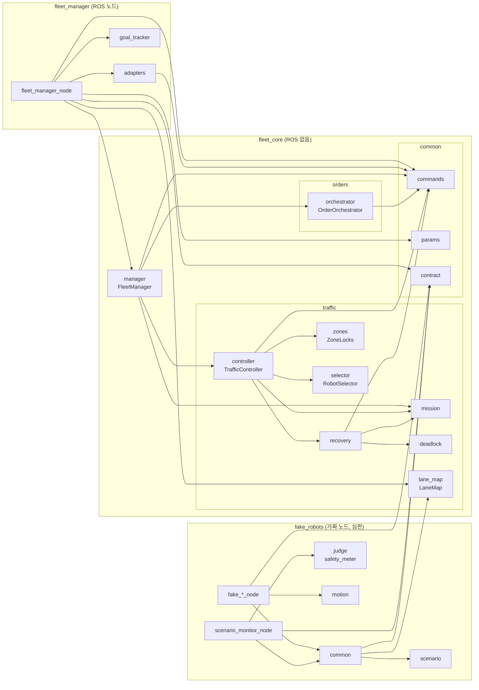

# 관제 개발 참고

관제(`pc/fleet_core`, `pc/fleet_manager`)와 시험(`sim/fake_robots`, `tools`)을 고치는 사람을 위한 내용입니다.

## 모듈 의존성 (누가 누구를 import하나)



`orders`와 `traffic`은 서로 import하지 않고, `manager`가 `common/commands.py`의 명령으로 둘 사이를 잇습니다. `pc/fleet_core/test/test_fms_boundary.py`가 이 경계를 검사합니다. `traffic`은 주문과 바구니를 모릅니다.

낱말: fleet(핑키 3대), station(작업공간·출고), waypoint(지점, 레인 그래프의 꼭짓점. ROS 노드와 헷갈리지 않게 "노드"라 부르지 않습니다), lane(레인), zone(구역, 잠금 단위), dock/parking.

## 가짜 노드

| 노드 | 맡은 일 |
|---|---|
| `fake_pinky_node` | `/{pinky}/state`, `move_to`, `dock`. 고장 `comm_loss`, `nav_abort`, `stuck`, `operator_remove` |
| `fake_workcell_node` | `/workcell/fill_basket`, `/arm1/state`, `/arm2/state`. 고장 `arm_fail`, `arm.fail_rate` |
| `fake_arm_node` | arm3만. `/arm3/swap_basket`, `/arm3/state`. 고장 `swap_partial`, `arm.fail_rate` |
| `fake_vision_node` | `/arm1/vision/items`, `/arm2/vision/items`. 실제 재고를 보여 주고 집어 간 만큼 줄어듭니다 |
| `fake_central_node` | 재고 기록과 주문 목록, `/central/orders`, `submit_order`, `report_order`, `set_run_mode`, 중앙 이벤트 코드 |
| `scenario_monitor_node` | 심판. 결과 파일을 쓰고 launch를 끝내며, `operator_remove` 때 관리자 대신 `confirm_clear`를 부릅니다 |

## 실행 결과

시나리오가 끝나면 launch가 스스로 종료되고, `result_dir`에 `summary.json`, `events.csv`, `zones.csv`, `robots.csv`, `releases.csv`가 남습니다. 심판은 가짜 로봇이 `/sim/truth/<로봇>`으로 발행하는 잡음 없는 위치로 판정하고, 실물 로봇은 보고된 위치로 판정합니다.

시험은 Fast DDS(`rmw_fastrtps_cpp`) 기준입니다. Fast DDS는 다른 프로세스의 QoS 깊이를 알려 주지 않으므로 `check_interfaces.py`는 깊이를 빼고 신뢰성과 지속성만 검사합니다.

## 시나리오

`sim/fake_robots/scenarios/*.yaml`에 여섯 개가 있습니다. 모든 로봇은 대기 지점에서 빈 바구니를 싣고 시작합니다.

| 이름 | 내용 | 확인하는 것 |
|---|---|---|
| `basic_orders` | 주문 6건, 고장 없음 | 전부 출고, 등록 순서 유지 |
| `order_burst` | 한꺼번에 8건, 진행 중 2건 추가 | 주문이 밀려 있으면 대기 구간을 거치지 않고 바로 작업공간으로 돌아감 |
| `shared_lane_failure` | 통신 두절과 주행 실패 | 구역 잠금 유지, `COMM_LOST`, `COMM_RESTORED`, `GOAL_RETRY`, 전부 출고 |
| `stock_shortage` | 재고 0인 품목, 기록만 있고 실물 없는 품목, 용량 초과 주문 | PARTIAL과 HELD, `OUT_OF_STOCK`과 `STOCK_MISMATCH` 구분 |
| `stuck_robot` | 돌아오던 로봇이 대로(양방향 구간)에서 영구 정지 | 뒤따르는 로봇이 막히고 `COMM_LOST`, `ZONE_WAIT_LONG`이 남 |
| `operator_recovery` | 팔 고장 3회로 ERROR, 관리자가 로봇을 치움. 다음 로봇도 담는 도중 치움(팔 취소가 느림) | `ORDER_REQUEUED` 후 앞으로 되돌아가고, 세 번째 로봇이 앞 작업의 취소 결과를 기다렸다가 전부 끝냄 |

`expect` 항목은 다음과 같습니다. 숫자는 정확히 일치해야 통과합니다(`_min`으로 끝나는 것은 그 값 이상).

| 항목 | 뜻 |
|---|---|
| `all_orders_finished` | 모든 주문이 최종 보고됨(true) 또는 일부가 끝나지 못함(false) |
| `orders_shipped`, `orders_partial`, `orders_held` | `ORDER_SHIPPED`, `ORDER_PARTIAL`, `ORDER_HELD` 건수. 적지 않으면 검사하지 않습니다 |
| `orders_shipped_min` | 최소 출고 건수. 고장이 있는 시나리오는 이 값이나 `orders_shipped`가 1 이상이어야 파일을 읽을 수 있습니다 |
| `fifo_violations` | `ORDER_BOUND` 순서가 등록 순서와 다르거나 출고(SHIPPED, PARTIAL) 순서가 묶인 순서와 다른 건수. `ORDER_REQUEUED`된 주문은 다음에 묶여야 하고, 되돌림 없이 두 번 묶이면 위반입니다 |
| `dual_arm_overlaps` | arm1과 arm2가 동시에 PLACING인 횟수. 각 팔 상태의 `stamp`로 비교합니다. 출고한 주문에 두 팔이 다 필요했는데 PLACING을 못 본 팔이 있으면 실패입니다 |
| `direct_returns_min` | 출고 구역에서 대기 구간을 거치지 않고 작업공간으로 돌아간 횟수의 최솟값 |
| `parked_while_backlog` | 묶이지 않은 주문이 로봇 수 이상인데 출고 구역에서 대기 구간으로 들어간 횟수 |
| `zone_holder_max` | 한 구역에 실제로 동시에 있었던 로봇 수의 최댓값 |
| `released_without_position_check` | 로봇이 아직 구역을 벗어나지 않았는데 해제된 횟수 |
| `unheld_zone_pose` | 잠그지 않은 구역에 로봇이 있었던 횟수 |
| `timed_out` | 제한 시간까지 끝나지 못함. 기본 false이고, 일부러 끝나지 않는 시나리오만 true로 적습니다 |
| `unexpected_errors` | `events_include`, `event_counts`에 없는 코드의 ERROR 이벤트 수. 기본 0 |
| `order_results` | 주문별 최종 결과. 예: `{O-001: SHIPPED, O-003: HELD}` |
| `events_include` | 반드시 나와야 하는 이벤트 코드 |
| `event_counts` | 코드별로 정확히 나와야 하는 횟수. 예: `{OUT_OF_STOCK: 2, STOCK_MISMATCH: 2}` |

고장 형식은 다음과 같습니다.

```yaml
faults:
  - {at_s: 40, robot: pinky2, type: comm_loss, duration_s: 20}
  - {at_s: 50, robot: pinky1, type: nav_abort, count: 2}
  - {at_s: 50, robot: pinky1, type: stuck}
  - {at_s: 60, robot: pinky1, type: operator_remove}   # 코스에서 치운 뒤 심판이 confirm_clear를 부릅니다
  - {at_s: 0, arm: arm1, type: arm_fail, count: 3}     # after_items: N을 주면 N개를 담은 뒤 고장납니다
  - {at_s: 0, type: swap_partial, count: 1}            # 찬 바구니는 꺼내지만 빈 바구니를 못 놓습니다
```

## 일부만 실물로

```bash
ros2 launch iponic_bringup pc.launch.py use_fake:=true fake_robots:="pinky2 pinky3"   # pinky1만 실물
ros2 launch iponic_bringup pc.launch.py use_fake:=true fake_arms:="arm3"              # 작업공간 서버와 비전만 실물
ros2 launch iponic_bringup pc.launch.py use_fake:=true fake_arms:="arm1 arm2"         # arm3만 실물
ros2 launch iponic_bringup pc.launch.py use_fake:=false                               # 전부 실물
```

`fake_arms`에서 arm1과 arm2는 같이 쓰거나 같이 뺍니다. 서버 하나(`/workcell/fill_basket`)가 두 팔을 맡기 때문이고, 하나만 쓰면 launch가 오류로 멈춥니다. 두 이름을 쓰면 가짜 작업공간 서버와 비전 2개가, arm3을 쓰면 가짜 출고 팔이 뜹니다.

## 값을 바꿀 곳

| 정해지는 값 | 고칠 곳 | 코드 수정 |
|---|---|---|
| 토픽, 액션, 서비스 이름 | `contract.yaml`의 `name` | 없음 |
| QoS | `contract.yaml`의 `qos_profiles` | 없음 |
| 메시지 필드 | `interfaces`의 정의, `fleet_manager/adapters.py`, `sim/fake_robots`에서 그 메시지를 쓰는 노드 | 이 파일들만. 타입을 통째로 바꾸면 `fleet_manager_node.py`의 타입 지정도 고칩니다. |
| 로봇 상태 값 | `RobotState.msg`의 상수, `sim/fake_robots/fake_robots/judge.py`의 `IDLE` 비교 | 이 파일들만. `fleet_core`는 이 값으로 판단하지 않습니다. |
| 팔 상태 값 | `ArmState.msg`의 상수, `judge.py`의 `PLACING` | 이 파일들만 |
| 이벤트 코드 | `fleet_core`, `fake_central_node.py`, `judge.py`, 시나리오의 `events_include` | 이 파일들만 |
| 관제와 FSM의 역할 경계 | `fleet_manager`의 `fleet_manager_node.py`와 `adapters.py` | `fleet_core`는 수정하지 않음 |
| 지점 좌표와 원점 | `lane_map.yaml`의 `waypoints`, `origin_m` | 없음 |
| 레인 폭과 레인 시작 판정 | `lane_map.yaml`의 `half_width_m`, `lane_entry_m` | 없음 |
| 레인과 양방향 구간 | `lane_map.yaml`의 `lanes`, `two_way`, `bundle_two_way` | 없음 |
| 잠금 단위 묶기 | `lane_map.yaml`의 `units` | 없음 |
| 해제 거리 d | `fleet_params.yaml`의 `release_distance_m` (근거식은 그 파일의 주석) | 없음 |
| 바구니 용량 | `fleet_params.yaml`의 `basket_capacity` | 없음. 관제와 가짜 중앙이 같은 파일을 읽습니다 |
| 일부만 담겨도 출고할지 | `fleet_params.yaml`의 `ship_partial` | 없음 |
| 로봇 반경, 시간 제한, 재시도 | `fleet_params.yaml` | 없음 |
| 로봇 이름과 대수 | `pc.launch.py`의 `robots`, `contract.yaml`의 `placeholders` | 없음 |
| 작업공간과 출고 구역, 대기 지점 | `lane_map.yaml`의 `stations`, `parking` | 없음 |

`lane_map.yaml`과 `fleet_params.yaml`은 `pc/fleet_core/fleet_core/data/`에 있습니다. 설치된 기본값 대신 다른 파일을 쓰려면 launch 인자 `map_file`, `params_file`, `contract_file`을 지정합니다.
